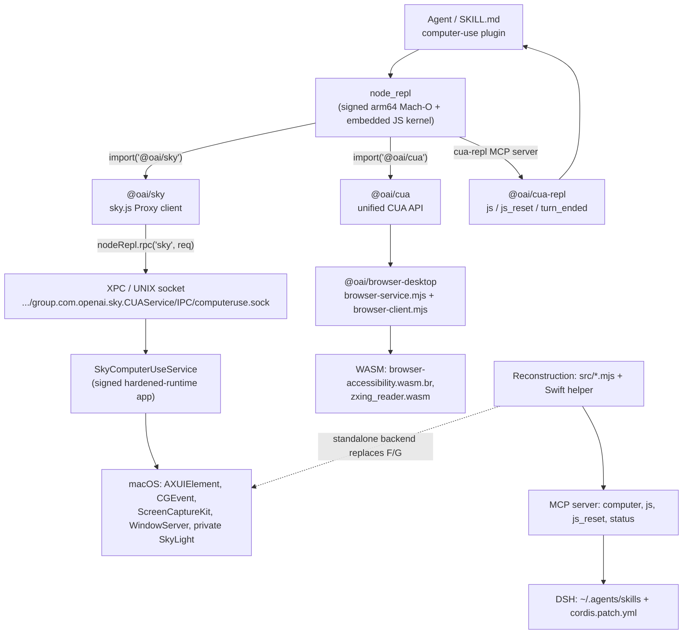

# Codex Computer Use — Recovered Architecture

Generated 2026-11-10 (Asia/Shanghai). Scope: the shipped ChatGPT/Codex
computer-use artifacts recovered into `recovered-source/`, plus the
source-backed reconstruction in `scripts/codex-computer-use-mcp/` and its
DeepSeek Harness adapter.

**Honesty statement.** This document describes *shipped artifacts* and a
*reconstruction*. Original author source — comments, local variable names,
pre-minification identifiers, and the Swift/Rust implementation — was not
shipped and is **not recovered**. The readable JavaScript in
[`readable/`](readable/MANIFEST.md) is formatting-only (identifiers preserved);
three browser views in `readable/ast-verified/` additionally passed normalized
AST equivalence checks. Nothing here is a runtime-execution claim: all
statements are static observations or labelled inferences. Evidence IDs are
indexed in [`REA-EVIDENCE.md`](REA-EVIDENCE.md).

## Contents

1. [Layered overview](#1-layered-overview)
2. [Boot sequence and RPC](#2-boot-sequence-and-rpc)
3. [`@oai/sky`](#3-oaisky)
4. [`@oai/cua`](#4-oaicua)
5. [`@oai/cua-repl` and the MCP plugin layer](#5-oaicua-repl-and-the-mcp-plugin-layer)
6. [`node_repl` privileged runtime](#6-node_repl-privileged-runtime)
7. [`@oai/browser-desktop`](#7-oaibrowser-desktop)
8. [Native service](#8-native-service)
9. [Sender authorization gate](#9-sender-authorization-gate)
10. [Reconstruction and DSH](#10-reconstruction-and-dsh)
11. [Reference tables](#11-reference-tables)
12. [Unknowns and coverage](#12-unknowns-and-coverage)

---

## 1. Layered overview



Three parallel front ends converge on the same native service: the desktop
`@oai/sky` API used by the skill, the `@oai/cua` unified API (computer +
browser), and the `@oai/cua-repl` MCP plugin (`js`, `js_reset`, `turn_ended`).
The reconstruction replaces the product-host-bound native service with a
source-built Swift helper while reusing the recovered `@oai/*` JavaScript.

---

## 2. Boot sequence and RPC

The shipped skill ([`skill/skills/computer-use/SKILL.md`](skill/skills/computer-use/SKILL.md))
instructs the agent to bootstrap once per fresh `node_repl` session:

```js
globalThis.sky = (await import("@oai/sky")).sky;
```

`packages/sky/dist/project/cua/sky_js/src/index.js` is a one-line barrel
`export{sky}from"./sky.js";`. `sky.js` (minified; readable derivative at
[`readable/packages/sky/.../sky.js`](readable/packages/sky/dist/project/cua/sky_js/src/sky.js))
does the following, with mangled bindings preserved:

1. Reads `const n = globalThis.nodeRepl` and, when `typeof n.rpc === "function"`,
   awaits `a({ type: "setup" })` to obtain `{ target, methods }` from the trusted
   service. Failures are retained in `s` and replayed on later calls.
2. Builds `l = new Proxy({}, { get, getOwnPropertyDescriptor, has, ownKeys })`
   whose traps forward to a lazily created client `c()`.
3. `c()` caches `d`. Without a `node_repl` it falls back to
   `create_client(load_options())`; with `n.rpc` it constructs `o = { target }`
   and, for every method name returned by `setup`, installs
   `(...args) => a({ type: "execute", method, args })`.
4. `a(request)` wraps `nodeRepl.rpc("sky", request)` in the tslib `__awaiter`
   helper and post-processes three results:
   - `get_screenshot` → `u(e)` splits the `data_url` comma, base64-decodes with
     `Buffer.from`, and returns `{ filepath, bytes: Uint8Array, data_url }`;
   - `get_window_state` on Linux → `o(t.ax_tree, t.focused_modal)` from
     `targets/linux/accessibility_tree.js`;
   - `stop_audio_recording` → `u(e)`.
5. Linux-only `drag_handle` (when `methods.includes("drag_handle")`) returns an
   object with `start`, `move_to`, `end` bound to a `crypto.randomUUID()` handle.

Every action is therefore an RPC, not a direct OS call. The agent-facing
surface is the `TypeSky` object documented in the shipped SKILL.md.

### Shipped `TypeSky` API (from SKILL.md)

| Method | Arguments | Returns |
| --- | --- | --- |
| `click` | `app`, `element_index?`, `x?`, `y?`, `mouse_button?`, `click_count?`, `key?`, `duration?` | `Promise<void>` |
| `drag` | `app`, `from_x`, `from_y`, `to_x`, `to_y` | `Promise<void>` |
| `get_app_state` | `app`, `disableDiff?` | `Promise<AppState>` |
| `list_apps` | — | `Promise<App[]>` |
| `paste` | `app`, `text`, `format: "text" \| "md" \| "html"` | `Promise<void>` |
| `perform_secondary_action` | `app`, `element_index`, `action` | `Promise<void>` |
| `press_key` | `app`, `key`, `duration?` | `Promise<void>` |
| `scroll` | `app`, `element_index?`, `x?`, `y?`, `direction`, `pages?` | `Promise<void>` |
| `select_text` | `app`, `element_index`, `text`, `prefix?`, `suffix?`, `selection_type?` | `Promise<void>` |
| `set_value` | `app`, `element_index`, `value` | `Promise<void>` |
| `type_text` | `app`, `text` | `Promise<void>` |

```ts
type App = { id: string; displayName?: string; lastUsedDate?: string;
             useCount?: number; isRunning?: boolean };
type AppState = { app: string; screenshot: Screenshot | null; text: string };
type Screenshot = { url: string };            // always a file:// URL in the skill
type Direction = "up"|"down"|"left"|"right"|"u"|"d"|"l"|"r";
type SelectionType = "text"|"cursor_before"|"cursor_after";
type MouseButton = "left"|"right"|"middle"|"l"|"r"|"m";
```

The skill also carries the **Computer Use Confirmations Policy** (hand-off
required, always-confirm, pre-approval, no-confirmation taxonomies), a
screenshot-reading recipe via `nodeRepl.emitImage`, and the rule that
`get_app_state` transparently launches apps and returns diffed AX trees.

---

## 3. `@oai/sky`

Package `0.7.13` ([`packages/sky/package.json`](packages/sky/package.json)),
ESM, main `dist/project/cua/sky_js/src/index.js`, exports `.` and `./service`,
types `dist/project/cua/sky_js/src/index.d.ts`. Its `publishConfig.executableFiles`
lists the bundled `bin/mac/{normal,relaxed}/Codex Computer Use.app` and the nested
helper executables — i.e. the npm package shipped the native app.

Module layout (recovered under `packages/sky/dist/project/cua/sky_js/`):

| Area | Files | Role |
| --- | --- | --- |
| entry | `index.js`, `sky.js`, `service.js`, `create_client.js`, `load_options.js` | Proxy client, service bootstrap, options |
| `core/` | `cli.js`, `package_bin.js`, `uint8.js` | CLI/process/binary helpers |
| `targets/{mac,linux,windows}/` | `click.js`, `type_text.js`, `key_down.js`, `accessibility_tree.js`, `errors.js`, … | per-platform primitives |
| `types/` | `Direction.d.ts`, `MouseButton.d.ts`, `Point.d.ts`, `SkyClient.d.ts`, `index.d.ts` | shared types |
| `types/window/` | `AppState`, `GetAppState`, `Paste`, `SelectText`, `SetValue`, `WindowComputerUseClient`, … | per-window API |
| `types/window2/` | `ActivateWindow`, `GetWindow`, `GetWindowState`, `LaunchApp`, `ListWindows`, `Audio`, `Drag`, `Screenshot`, … | second-generation window API |
| `types/full-desktop/` | `MoveRelative`, `DragHandle`, `ClipboardRead/Write/Release`, `Start/StopAudioRecording`, `TypeCharacters`, `ListApps`, … | full-desktop API |
| `scripts/` | `install-computer-use-package`, `generate-docs`, `test-build`, `windows-wgc-e2e` (`.d.ts` only) | build/tooling type declarations |

The `.d.ts` families show three API generations (`window`, `window2`,
`full-desktop`) with audio recording, clipboard handles, drag handles, and
window activation — a superset of the `TypeSky` surface the skill exposes.

---

## 4. `@oai/cua`

Package `0.2.6` ([`packages/cua/package.json`](packages/cua/package.json)).
`dist/lib/js/oai_js_cua/src/cua.js` (minified; readable derivative
[here](readable/packages/cua/dist/lib/js/oai_js_cua/src/cua.js)) defines:

```js
import{__awaiter as o}from"../../oai_js/node_modules/tslib/tslib.es6.js";
import{setupBrowserRuntime as s}from"../../oai_js_browser/dist/skill/scripts/browser-client.js";
import{sky as r}from"../../../../project/cua/sky_js/src/sky.js";
import{get_state as t}from"./get_state.js";
const e={initialize:function(){ /* setupBrowserRuntime({undocumentedApiMembers:["Tab.ax"]}) */ },
        computer:null,browsers:null,documentation:null};
export{e as cua};
```

`initialize()` calls `setupBrowserRuntime({ undocumentedApiMembers: ["Tab.ax"] })`,
then assigns `cua.computer = sky`, `cua.browsers = …`, `cua.documentation = …`,
and finally `get_state({ browsers, computer })`. In other words `@oai/cua` is a
*unified* facade that couples the desktop `sky` client with the browser runtime
and installs the tinysky documentation.

Supporting modules:

- `get_state.js`, `get_apps.js`, `get_browsers.js`, `get_browser_tabs.js` — state
  and inventory queries.
- `core/display.js`, `core/positive_pixels.js`, `core/screenshot_bytes.js` —
  screenshot/diff helpers.
- `tinysky_alt/` — `bind_mac_app.js`, `bind_linux_app.js`, `bind_windows_app.js`,
  `bind_tab.js`, `setup_browser.js`, `create_browser_api.js`,
  `create_tinysky_alt.js`, `create_documentation.js`, `read_documentation.js`,
  `one_screenshot.js`, `globals.js`, `require_plain_text.js`,
  `duration_seconds.js`, `tab_reference.js`: the alternate "tinysky" surface and
  its generated documentation.
- `tinysky_browser/create_tinysky_browser.js`,
  `tinysky_vision_only/{create_tinysky_vision_only,globals}.js` — browser-only
  and vision-only variants.
- `docs/tinysky-alt-*.md` — the original tinysky-alt instruction documents
  (linux/mac/windows/no-CUA, core-cua-repl, node-repl, browser APIs,
  confirmations), copied into `docs/cua/`.

---

## 5. `@oai/cua-repl` and the MCP plugin layer

Package `0.1.2`. `bin/cua-repl.mjs` is a tiny launcher:

```js
#!/usr/bin/env node
import * as cua_repl from "@oai/cua-repl";
try { await cua_repl.launch(); }
catch (error) { console.error(`cua_repl could not start: ...`); process.exitCode = 1; }
```

`dist/lib/js/oai_js_cua_repl/src/` holds `index.js`, `launch.js`,
`instructions.js` (+ `.d.ts`). `instructions/*.md` contains the original runtime
prompts: `audio-attachments.md`, `banner.js`, `browser-cloud-preference.md`,
`browser-disabled.md`, `browser-orbit-preference.md`, `computer-disabled.md`,
`code.md`, `reset.md`, `server.md`, and `linux/`, `macos/`, `windows/` variants.

### Shipped MCP registration

[`runtime-config/.mcp.json`](runtime-config/.mcp.json) registers `cua_repl`:

| Key | Value |
| --- | --- |
| `command` | `/Applications/ChatGPT.app/Contents/Resources/cua_node/bin/node` |
| `args` | `--import …/require-browser-access.mjs`, `@oai/cua-repl/bin/cua-repl.mjs` |
| `enabled_tools` | `js`, `js_reset`, `turn_ended` |
| `omit_tools_from` | `code_mode`, `deferred` |
| `startup_timeout_sec` | `120` |
| `tools.js.output_token_limit` | `25000` |
| `env.NODE_REPL_TRUSTED_SERVICES` | `{"browser":"@oai/browser-desktop/service","sky":"@oai/sky/service"}` |
| `env.CUA_REPL_ENABLED_SURFACES` | `browser,computer` |
| `env.BROWSER_USE_AVAILABLE_BACKENDS` | `chrome,iab,mcpapps` |
| `env.BROWSER_USE_CODEX_APP_VERSION` | `26.1023.50603` |
| `env.CUA_REPL_NODE_REPL_PATH` | `…/cua_node/bin/node_repl` |

`packages/cua-repl/plugin/.mcp.template.json` is the disabled template variant
(`enabled: false`, same `enabled_tools`, `js.output_token_limit: 25000`).

### Hooks

Both [`runtime-config/plugin.json`](runtime-config/plugin.json) (version
`26.1023.50603`, name `unified-computer-use`, `mcpServers: "./.mcp.json"`) and
`packages/cua-repl/plugin/.codex-plugin/plugin.json` (version `0.1.0`) wire
`Interrupt`, `SubagentStop`, and `Stop` to an `mcp_tool` call:

```json
{ "type": "mcp_tool", "server": "cua_repl", "tool": "turn_ended",
  "input": { "hook_event_name": "${hook_event_name}",
             "session_id": "${session_id}|${agent_id}", "turn_id": "${turn_id}" } }
```

`turn_ended` therefore tears down per-turn browser/computer state at turn
boundaries. `runtime-config/require-browser-access.mjs` is a one-line
`process.env.BROWSER_USE_ACCESS_EXECUTOR_ID ??= "";` preload.

---

## 6. `node_repl` privileged runtime

`node_repl` is a signed arm64 Mach-O (19,310,480 bytes,
`95b4acccef72ad97526abadb9a96d385c8f13de9b4152d7e225d01c0f42d51f9`) whose
embedded JavaScript was recovered into [`node-repl/`](node-repl/). It is a
JSON-lines supervisor/worker host, not a plain REPL:

| File | First-line comment / role |
| --- | --- |
| `kernel.js` | `// Node-based kernel for node_repl. // Communicates over JSON lines on stdin/stdout. // Requires Node started with --experimental-vm-modules.` |
| `privileged-node-repl.js` | `// Trusted-only Node REPL host bridge and privileged capabilities.` |
| `trusted-worker.js` | `// Trusted service host. JSONL on stdout is reserved for the Rust supervisor.` |
| `worker-runtime.js` | `AsyncLocalStorage`, `inspect`, realm-safe value handling |
| `realmChecks.js` | `Realm-safe checks for values passed from a Node REPL VM context` (avoids cross-realm `instanceof`) |
| `diagnostics.js` | redacted diagnostic source (`maxLength = 16_384`), code replacement |
| `tracing.js` | `AsyncLocalStorage` + `performance`, `responseMetaTraceVersion = 1`, `maxResponseMetaTraceSpans = 1024`, aligned with `src/otel_traces.rs` |
| `meriyah.umd.min.js` | bundled JavaScript parser |
| `privileged-node-repl-config.js` | privileged config builder |

The reconstruction mirrors this environment in
`scripts/codex-computer-use-mcp/src/config.mjs` `runtimeEnvironment()`:

| Variable | Value / purpose |
| --- | --- |
| `HOME`, `LOGNAME`, `PATH`, `SHELL`, `TERM`, `USER`, `TMPDIR`, `LANG`, `LC_ALL`, `LC_CTYPE` | pass-through allowlist |
| `CODEX_CUA_HELPER`, `CODEX_CUA_VISUAL_CURSOR` | optional helper/cursor overrides |
| `CUA_REPL_ENABLED_SURFACES` | `"computer"` (reconstruction; shipped value `browser,computer`) |
| `NODE_REPL_NODE_MODULE_DIRS` | `realpath(modulesRoot)` |
| `NODE_REPL_TRUSTED_CODE_PATHS` | `[realpath(modulesRoot), packageRoot]` joined by `path.delimiter` |
| `NODE_REPL_TRUSTED_SERVICES` | `{"sky": "…/src/standalone-sky.mjs"}` in standalone mode, else `@oai/sky/service` |
| `NODE_REPL_TRUSTED_RPC_ENABLED` | `"1"` |
| `NODE_REPL_UNTRUSTED_ENV_ALLOWLIST` | `"CUA_REPL_ENABLED_SURFACES"` |
| `NODE_REPL_JS_BANNER` | `await import("@oai/cua/tinyskyAlt");` |
| `CODEX_CUA_SERVICE_PROCESS` | `"1"` |
| `SKY_CUA_SERVICE_PATH` | `~/.tcodex/computer-use/Codex Computer Use.app` (overridable) |
| `SKY_CUA_SERVICE_NATIVE_PIPE_PATH` | `~/Library/Group Containers/2DC432GLL2.com.openai.sky.CUAService/IPC/computeruse.sock` |
| `SKY_ENABLE_AUDIO` | `"0"` |
| `NODE_REPL_DISABLE_ANALYTICS` | `"1"` |
| `BROWSER_USE_DISABLE_AMBIENT_NETWORK` | `"1"` |

`runtimeStatus()` reports the backend, input mode, node binary, sources root,
native service, socket, helper, and macOS permission state.

---

## 7. `@oai/browser-desktop`

Package `0.1.1`. Two shipped bundles:
`scripts/browser-service.mjs` (2,110,036 bytes minified) and
`scripts/browser-client.mjs` (170,131 bytes). The earlier recovery produced
AST-verified readable views (normalized AST equivalence + `node --check`) copied
to [`readable/ast-verified/`](readable/ast-verified/) and prettier-formatted
copies in `readable/packages/browser-desktop/`. Its
[`README`](../scripts/codex-computer-use-source/readable-browser/README.md)
documents seven embedded programs extracted from static literals in
`browser-service.mjs`:

| Program | Carrier line | Shipped binding | Kind |
| --- | --- | --- | --- |
| `q5` | 31601 | `q5` | template literal, cooked via Babel |
| `webMcp` | 53666 | `T0` | template literal (WebMCP) |
| `standalone-helper` | 59699 | none | escaped string literal |
| `PlaywrightInjected` | 61114 | `hF` | escaped string literal |
| `functionDeclaration` | 62151 | `functionDeclaration` | template literal |
| `querySelectorStrictWithVisibleFallback` | 63061 | `al` | template literal |
| `n` | 79094 | `jme` | canonical base64 (`.decoded.mjs`) |

Their `.decoded.js|mjs` files and generated `.js.map` files are in
`browser/embedded/`. The generated maps address **shipped bundle text**, not
author source; `symbol-index.json` (7.8 MB) and `dependency-inventory.json`
record shipped top-level bindings and every installed package manifest.

`environment-docs/` carries four deployment variants — `cloud/`,
`codex-app/`, `orbit/`, `training/` — with markdown on API use behavior,
browser safety/troubleshooting, tab capabilities (`cdp`, `webmcp`,
`browserAuth`, `pageAssets`, `botDetection`), screenshots, file uploads,
confirmations, visibility, and `api.json` / `documents.json`.

Two WASM modules ship: `browser-accessibility.wasm.br` (Brotli-compressed,
decoded `browser-accessibility.wasm`) and `zxing_reader.wasm`. WAT disassembly
is in `browser/wasm/`. The bounded
[summary](browser/wasm/browser-accessibility.wat.summary.md) of the 202,768,105
byte WAT reports textual counts `(func` 81,447, `(type` 133,150, `(global`
5,163, 11 exports and 34 import pairs. `zxing_reader` WAT round-trips
byte-identically; the accessibility WAT reassembly failed inside the JS WABT
toolkit with a memory-access error. **WAT is generated disassembly, not author
source.** `@oai/cdp-browser-backend@0.6.7` appears only in package-manager
metadata — no installed source was found.

---

## 8. Native service

### Binary identities

| Binary | Bytes | SHA-256 | UUID / note |
| --- | ---: | --- | --- |
| `node_repl` (archived) | 19,310,480 | `95b4acccef72ad97526abadb9a96d385c8f13de9b4152d7e225d01c0f42d51f9` | arm64 Mach-O, embedded JS recovered |
| `SkyComputerUseService` (October snapshot) | 25,117,232 | `e798d6a292fb5d93536ae9f6954e9809f0833bcf38d1ff50624f1e2268723dea` | `AD22C18C-5BF8-30E8-A197-CD63389E6DD9` |
| `SkyComputerUseService` (**installed, newer**) | 21,633,216 | `469500545c940ecb20541d71a979461ea6bd22e92b513a87fa57eab90cd1061a` | `6B24ECFC-AD72-3AAF-93F3-7CE459EE0D4D` |
| `SkyComputerUseClient` (nested) | 15,684,960 | `5efa7ff505fe22110a0a900039c9b47cbf6e720c6da9a69ec1fd983a5ba034b1` | `SharedSupport/SkyComputerUseClient.app` |

`inspect_macho` (`ev_90044118…`) reports arm64 thin, little-endian, 64-bit,
file type 2, flags `0x04218085`, 90 load commands, 70 dylib dependencies,
4,692 imports and 43,876 exports (**non-exhaustive** — stripped/toolchain-hidden
symbols may be absent), and 5 segments.

### Bundle layout

`~/.codex/computer-use/Codex Computer Use.app/`:

```
Contents/MacOS/SkyComputerUseService
Contents/Info.plist, PkgInfo, embedded.provisionprofile
Contents/_CodeSignature/CodeResources
Contents/Resources/CUAAppIcon.icns, Assets.car, BUILD.bazel
Contents/Resources/Package_{SkyPermissions,ComputerUse,Appshot,SlimCore}.bundle
Contents/Resources/SwiftProtobuf_SwiftProtobuf.bundle
Contents/SharedSupport/Codex Computer Use Installer.app
Contents/SharedSupport/SkyComputerUseClient.app
Contents/SharedSupport/CUALockScreenGuardian.app
```

`~/.codex/computer-use/config.json` holds
`{"accentColor":"#007acc","direction":"ltr","locale":"en-US","strings":{"usingComputer":"ChatGPT is using your computer","escToCancel":"Esc to cancel"}}`;
`sessions/*.toml` are per-session records.

### Signing, entitlements, build metadata

From `ev_c51b0b6d…` (`inspect_signature`) and `ev_79f9c5b9…` (`inspect_plist`):

| Fact | Value |
| --- | --- |
| Identifier / team | `com.openai.sky.CUAService` / `2DC432GLL2` |
| Authority chain | Developer ID Application: OpenAI OpCo, LLC → Developer ID Certification Authority → Apple Root CA |
| Designated requirement | `identifier "com.openai.sky.CUAService" and anchor apple generic and certificate 1[field.1.2.840.113635.100.6.2.6] and certificate leaf[subject.OU] = "2DC432GLL2"` |
| cdHash | `1d127a43dc7ffa326c56798c88eb9419fbd8822b` |
| Hardened runtime | `true`; timestamp 3 Nov 2026 09:11:34 |
| Entitlements | `application-identifier`, `team-identifier`, `application-groups`, `automation.apple-events`, `personal-information.addressbook`, `personal-information.calendars`, `keychain-access-groups: ["2DC432GLL2.*"]` |
| Version | `26.1102.1001824` (`CFBundleVersion 1001824`) |
| Toolchain | macOS 26.1 SDK (`25B74`), Xcode `17B100`/`2611`, min macOS 14.4 |
| UI | `LSUIElement: true`, display name `ChatGPT Computer Use`, icon `CUAAppIcon` |
| Updates | Sparkle: `SUFeedURL https://oaisidekickupdates.blob.core.windows.net/mac/cua/alpha/appcast.xml`, `SUPublicEDKey 5Yw9jMXMH6O3mJZmpFuQT6ECfC3ZKBfVjWUVMNrElRo=`, automatic checks/updates enabled |
| Usage strings | Contacts (names/phone/email), Calendars (read/manage events), AppleEvents (message approval) |

### IPC / XPC

Socket: `~/Library/Group Containers/2DC432GLL2.com.openai.sky.CUAService/IPC/computeruse.sock`.
`ev_874ed2261a…` (macOS metadata reader, 300-record budget) decoded these
protocol declarations (class bodies, Swift witness/vtable and ivar coverage
remain partial/unsupported):

| Protocol | Selectors |
| --- | --- |
| `SAIComputerUseIPCXPCProtocol` | `subscribeToForegroundContextWithID:observer:withReply:`, `unsubscribeFromForegroundContextWithID:`, `sendRequestWithTypeName:requestData:codexMetadataData:fileDescriptors:withReply:` |
| `SAILockScreenGuardianXPCProtocol` | `beginUnlockGuardForThreadID:withReply:`, `completeUnlockGuardForThreadID:didUnlock:`, `retainAutoUnlockedLeaseForThreadID:`, `releaseAutoUnlockedLeaseForThreadID:` |
| `SAILockScreenGuardianClientXPCProtocol` | `lockScreenGuardianDetectedPhysicalInput` |
| `SAIRemoteHostedPIPContentHostXPCProtocol` | `publishPresentationWithID:threadID:turnID:contextID:width:height:withReply:`, `setSourceProcessIdentifier:forPresentationWithID:withReply:`, `publishFrameWithPresentationID:videoData:decoderConfiguration:codec:timestamp:isKeyFrame:withReply:`, `prepareOperationWithPresentationID:operationID:kind:contextID:width:height:fencePayload:withReply:`, `completeOperationWithPresentationID:operationID:withReply:`, `willEndStreamWithPresentationID:withReply:`, `invalidatePresentationWithID:withReply:`, `noteInteractionWithPresentationID:withReply:`, `setComputerUseCursorLocationWithX:y:isActive:withReply:` |
| `SAIRemoteHostedPIPContentProducerXPCProtocol` | `connectWithReply:`, `setMaxDisplaySize:withReply:`, `setVideoMaxPixelDimension:forPresentationWithID:withReply:`, `performActionWithPresentationID:kind:withReply:`, `didEndStreamWithPresentationID:withReply:`, `setPetLocationWithX:y:available:withReply:` |

`sendRequestWithTypeName:…` is the generic typed request bridge consistent with
the `{type, method, args}` RPC seen in `sky.js`;
`setComputerUseCursorLocationWithX:y:isActive:` corresponds to the animated
agent cursor.

---

## 9. Sender authorization gate

From [`native/REPORT.md`](native/REPORT.md) (bounded static analysis of the
*older* `e798d6a2…` binary; the newer installed build has not been
re-analyzed at function level):

- `0x100047dc0` (named `senderAuthorization` initializer) loads two default
  rule groups at `0x100181d7c` and `0x100181e88`.
- File-backed Swift small-string tables at `0x1014ea818`, `0x1014ea860`,
  `0x1014ea8a8` contain teams `2DC432GLL2`, `HX7739G8FX`, signing IDs `node`,
  `node_repl`, and basenames `node`, `node_repl`.
- Four default groups:

| Group | Address | Team | Signing/bundle IDs | Basenames |
| --- | --- | --- | --- | --- |
| interpreter | `0x100181d7c` | `2DC432GLL2` or `HX7739G8FX` | `node`, `node_repl` | `node`, `node_repl` |
| direct trusted | `0x100181e88` | `2DC432GLL2` | empty | empty |
| host ancestor | `0x100181f1c` | `2DC432GLL2` | `com.openai.codex`, `…alpha`, `…beta`, `…dev`, `…nightly` | empty |
| alternate ancestor | `0x100181fcc` | `MQ55VZLNZQ` | `codex-acp` | empty |

- Classifier `0x100180d50` returns raw states 0, 1, 2 or 3; call sites
  `0x10018d830` and `0x10018e32c` compare with 3.
- Raw flow: sender field `+0x30 == 1` → 0; direct-trusted match → 3 (no
  ancestry needed); interpreter mismatch → 1; interpreter match → `2 +
  ancestor_match` via `0x100180e6c`, which walks the sender's process-chain
  array at offset `0x88` from index 1.
- Socket peer reader `0x10019ab90` calls `getsockopt(fd, 0, 6, …)`, requires
  exactly 32 bytes, and obtains the PID with `audit_token_to_pid`; signing
  extraction uses `SecCodeCopyGuestWithAttributes`, `SecCodeCopyStaticCode`, and
  `SecCodeCopySigningInformation(…, 2, …)`.

Observed runtime rejections: `-10000: Sender process is not authenticated`,
including from the nested `SkyComputerUseClient`'s `cua mcp` CLI. **The exact
runtime condition causing the rejection was not established statically**; path
and signing-ID matches alone are insufficient evidence of launcher equivalence.
This product-host dependency is why the reconstruction uses its own helper.

---

## 10. Reconstruction and DSH

`scripts/codex-computer-use-mcp/` is **newly authored** code that re-implements
the observed interface; it is not recovered OpenAI source.

| Component | Role |
| --- | --- |
| `src/config.mjs` | backend selection (`standalone`/`source`/`codex`), paths, `runtimeEnvironment()`, `runtimeStatus()` |
| `src/server.mjs` | `McpServer` named `codex-computer-use` v0.2.0; registers `computer`, `js`, `js_reset`, `status` + `computer-use` prompt |
| `src/tools.mjs` | Zod schemas for 12 `computer` actions, `js`, `js_reset`, `status`; descriptions and prompts |
| `src/host.mjs`, `src/kernel-host.mjs` | persistent node_repl host using recovered `node-repl-embedded/` JS + shipped `@oai/*` packages |
| `src/standalone-sky.mjs` | trusted `sky` service implementation backed by the Swift helper (JSON-lines subprocess) |
| `src/cli.mjs` | `mcp`, `status`, `permissions`, `list-apps`, `state`, `screenshot`, `js`, `computer`, test runner |
| `src/native-host.mjs` | alternate native-host route (not the verified default) |
| `native/ComputerUse.swift`, `BackgroundInput.swift`, `AgentCursor.swift` | exact-window AX observation, selected-window capture, background-only input, click-through teal `AI` cursor |
| `build/Codex Computer Use Standalone.app`, `build/native-manifest.json` | signed ad-hoc helper + SHA-256 manifest verified by `scripts/setup.mjs --check` |

The Swift bridge dynamically loads and capability-checks `_AXUIElementGetWindow`,
`GetProcessForPID`, and `SLPSPostEventRecordTo`; missing symbols disable input
explicitly rather than falling back to global HID. Input is background-only: no
activation, window raising, global pointer delivery, or pointer warping. Missing
apps are not launched. `drag`, shared-clipboard `paste`, raw canvas clicks,
command shortcuts, and failing AX page-scroll actions return explicit refusals.

### DSH adapter

- [`SKILL.md`](../SKILL.md) frontmatter `name: open-codex-computer-use`, with a
  DSH paragraph; [`references/dsh.md`](../references/dsh.md) is the guide.
- `node scripts/install.mjs --dsh` symlinks this checkout into
  `~/.agents/skills/open-codex-computer-use` and appends one `- insert:` entry
  (`id: mcp-codex-computer-use`, `serverName: codex-computer-use`,
  `transport: stdio`, `command: scripts/computer-use`, `args: ["mcp"]`,
  `env: {CODEX_CUA_BACKEND: standalone}`) to `~/.dsh/cordis.patch.yml`,
  backing up the previous file and leaving other entries intact.
- Tool names: `mcp__codex-computer-use__computer`, `__js`, `__js_reset`,
  `__status`.
- [`scripts/verify-dsh.mjs`](../scripts/verify-dsh.mjs) checks the symlink, the
  patch entry, YAML syntax, and the live tool list (read-only).
- A new DSH session is required before MCP tools attach; the skill folder is
  discovered live. macOS Accessibility **and** Screen Recording must be granted
  to `Codex Computer Use Standalone` for AX trees, screenshots, clicks and
  typing.

---

## 11. Reference tables

### Evidence IDs (this session, REA 6.7.0)

| ID | Operation | Establishes |
| --- | --- | --- |
| `ev_900441182d0b9c5d93bcbe32cb4a17716b20e0081d650a26eb03aa3ef54293bd` | `inspect_macho` | installed service layout, load commands, imports/exports |
| `ev_c51b0b6da05020ac8d4718404efb1270f55e0b76fa1cc16b50d0b9b20eb973b8` | `inspect_signature` | signing, entitlements, hardened runtime |
| `ev_79f9c5b9c775ec93cc8d5acbf08c66dd01133c4ed2a8764f7a82f27855b81f14` | `inspect_plist` | Info.plist build/version/Sparkle facts |
| `ev_874ed2261ad9279096e77bd074ea73138674d5c32c50b8e644cedebfd2510393` | `inspect_native_dispatch_metadata` | ObjC/XPC protocols (partial) |
| `ev_b4429454a8a74f2d8958b9e4fb2f38ac626dc74c0f2b7d3777cc3862b614711f` | `analyze_javascript_application` (`@oai`) | 13 entry modules, 47,685 AST nodes, 76 findings |
| `ev_65bfffccc50fdb82d6774ac89d511d0bc97f54588f07ea75c60bae61ad295533` | `analyze_javascript_application` (`node-repl-embedded`) | 8 kernel files, 14,693 AST nodes, 93 findings |
| `ev_7c1200d29e069eb09471a05270a9fb826338c1743fad5750d0ad6f7f798d680f` | `analyze_javascript_application` (decoded browser chunks) | 7 chunks, 45,669 AST nodes, 16 findings |
| `ev_8d7337700494ae410ba7562be5c2eecb14e3e7b488f32177ad3f7aa19f920d12` | `inspect_artifact` | shipped plugin ZIP inventory, 0 integrity contradictions |

Earlier (October 2026): `ev_6bf4ad38748e942470dd3b1291d9d909d4b4b2c9b40c2098de2fc29b608cabc3`,
`ev_c273ddb9e0720fc839e2fb23d4e9e13ede659e16c48554898fb127f9911b8810`,
`ev_3a1c921fede34d813d260e2121dab79b9062ce414cb812f04e9d60a5f3ff0f87`.

### Key paths

| Material | Path |
| --- | --- |
| Shipped skill + plugin | `skill/skills/computer-use/SKILL.md`, `skill/.codex-plugin/plugin.json` |
| Shipped packages | `packages/{sky,cua,cua-repl,browser-desktop}/` |
| Readable derivatives | `readable/packages/**`, `readable/ast-verified/**`, `readable/MANIFEST.md` |
| Browser derivatives | `browser/embedded/`, `browser/format-only-installed/`, `browser/wasm/` |
| Node REPL kernel | `node-repl/` |
| Runtime config | `runtime-config/` |
| Docs | `docs/sky/`, `docs/cua/`, `docs/cua-repl/` |
| Native evidence | `native/REPORT.md`, `native/symbol-index-compact.txt`, `native/DERIVATIVES.md` |
| Recovery reports | `RECOVERY-REPORT.md`, `REA-EVIDENCE.md`, `manifest.json` |
| Reconstruction | `../scripts/codex-computer-use-mcp/` |

---

## 12. Unknowns and coverage

- **Version skew (now recovered):** `packages/` reproduces the October
  `26.1023.50603` snapshot (`@oai/sky` 0.7.13, `@oai/cua-repl` 0.1.2). The
  installed ChatGPT.app ships newer packages (`@oai/sky` 0.7.17,
  `@oai/cua-repl` 0.1.3) adding 44 source-bearing files — a Windows
  full-desktop client/API, `siwc.md` capability docs, and new cua-repl
  instructions. They are recovered separately in
  [`installed-newer/`](installed-newer/VERSION-SKEW.md) with formatted copies
  in `readable/installed-newer/`; two files exist only in the older snapshot.
  Both builds are retained, never mixed.
- **Not recovered:** exact original Swift (`SkyComputerUseService`) and Rust
  (`node_repl`) source; original comments, local names, types and
  pre-minification identifiers; original source maps / author TypeScript module
  boundaries. The shipped `@oai/*` packages contain compiled/minified `.js` and
  generated `.d.ts`, not author source.
- **Readable recovery limits:** prettier restored structure (e.g. `sky.js`
  1 → 101 lines, `cua.js` 1 → 21 lines, `browser-service.mjs` 9,373 → 80,883)
  while preserving mangled identifiers; 230/230 outputs pass
  `node --input-type=module --check`. Only the three `readable/ast-verified/`
  browser views additionally passed normalized AST equivalence. Formatting is
  not semantic re-verification for the rest.
- **Native:** Hopper produced no pseudocode — `binary_overview` and
  `get_objc_classes` were blocked by a macOS Automation permission denial
  (`provider_unavailable`). Ghidra/IDA/Kuna were not configured. Dispatch
  metadata coverage is partial (300-record budget); imports/exports are
  non-exhaustive.
- **Unshipped / unverified:** `@oai/cdp-browser-backend@0.6.7` (metadata only),
  browser DOM/CDP integration, native audio recording, lock-screen guardian
  integration, policy/telemetry, and product-host authentication. The
  `-10000` rejection condition was not established statically.
- **Static only:** all conclusions above come from shipped bytes and inert
  JavaScript parsing. They do not establish runtime execution, module loading,
  or behavioral equivalence. Runtime verification of the reconstruction is
  reported separately in `../scripts/codex-computer-use-mcp/RECOVERY-STATUS.md`.
